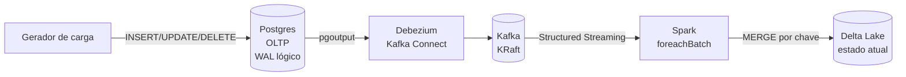

# CDC Lakehouse — Postgres → Debezium → Kafka → Spark → Delta


Pipeline de **Change Data Capture** de ponta a ponta: cada `INSERT`, `UPDATE` e
`DELETE` do banco transacional vira evento no Kafka e chega ao data lake como
**estado atual da tabela** — sem duplicar, sem perder delete, e sem quebrar
quando alguém adiciona uma coluna.

> O problema real: o dashboard mostra o pedido de ontem, mas ele foi cancelado
> hoje. Batch noturno não resolve. E replication slot mal configurado vira
> incidente de madrugada.

---

## Arquitetura



| Camada | Papel |
|---|---|
| **Postgres** | fonte da verdade, `wal_level=logical`, `REPLICA IDENTITY FULL` |
| **Debezium** | lê o WAL e publica o envelope `before/after/op/lsn` |
| **Kafka** | buffer durável e ordenado por partição |
| **Spark** | consome o tópico e aplica micro-lotes |
| **Delta** | tabela ACID com histórico (time travel) |

---

## As quatro garantias (e como cada uma foi provada)

### 1. Captura sem polling

O Debezium lê o **WAL**, não a tabela. Nada de `SELECT ... WHERE updated_at >`.
`REPLICA IDENTITY FULL` garante que updates e deletes carreguem as colunas
antigas — sem isso o consumidor não sabe qual chave apagar.

### 2. Ordenação por LSN

Cada evento traz `lsn` e `txId`. O job mantém **uma linha por pedido por lote**,
vence o maior LSN. Se o mesmo pedido mudou 10 vezes no intervalo, o lake recebe
o estado final — não 10 versões.

### 3. Idempotência no MERGE

```sql
MERGE INTO delta.`/data/delta/pedidos` AS alvo
USING staged AS origem
ON alvo.pedido_id = origem.pedido_id
WHEN MATCHED AND origem._op = 'd' THEN DELETE
WHEN MATCHED THEN UPDATE SET *
WHEN NOT MATCHED AND origem._op <> 'd' THEN INSERT *
```

Teste executado: **apaguei o checkpoint e reprocessei todos os eventos desde o
início**. Resultado: `688` linhas antes, `688` depois. Reprocessar não duplica.

### 4. Evolução de schema sem restart

`spark.databricks.delta.schema.autoMerge.enabled=true` faz o merge aceitar
colunas novas. Teste executado:

```sql
alter table loja.pedidos add column cupom text;
update loja.pedidos set cupom = 'BLACK50' where pedido_id % 7 = 0;  -- 98 linhas
```

Sem reiniciar nada, o Delta passou a ter a coluna `cupom`, com **98 linhas
preenchidas** — exatamente as que foram atualizadas na origem.

---

## Como rodar

Pré-requisito: Docker Desktop com ~5 GB livres.

```powershell
docker compose up -d --build
```

Isso sobe Postgres, Kafka, Debezium, o gerador de carga e o Spark. A primeira
execução baixa os jars do Delta e do conector Kafka (~2 min).

| Serviço | Acesso |
|---|---|
| Postgres (OLTP) | `localhost:5435` · `loja/loja/loja` |
| Kafka | `localhost:9092` |
| Kafka Connect (Debezium) | http://localhost:8083 |

Verificações:

```powershell
# o conector está rodando?
curl http://localhost:8083/connectors/loja-pedidos/status

# contagem na origem
docker compose exec -T postgres psql -U loja -d loja -c "select count(*) from loja.pedidos;"

# contagem no lake (deve bater)
docker compose exec -T spark /opt/spark/bin/spark-sql `
  --packages io.delta:delta-spark_2.12:3.2.0 `
  --conf spark.sql.extensions=io.delta.sql.DeltaSparkSessionExtension `
  --conf spark.sql.catalog.spark_catalog=org.apache.spark.sql.delta.catalog.DeltaCatalog `
  -f /opt/sql/verificacao.sql
```

---

## Demonstrações incluídas

```powershell
.\scripts\demo-evolucao.ps1   # adiciona coluna na origem e verifica no lake
.\scripts\demo-replay.ps1     # apaga o checkpoint e prova a idempotência
```

Ambas comparam **origem vs lake** e imprimem o veredito.

---

## Estrutura

```
cdc-lakehouse/
├── docker-compose.yml        # Postgres, Kafka, Connect, Spark, gerador
├── postgres/init/            # schema OLTP + replica identity
├── debezium/                 # configuração do conector
├── generator/                # gerador de carga (INSERT/UPDATE/DELETE)
├── spark/
│   ├── job.py                # Structured Streaming + foreachBatch
│   └── merge_sql.py          # SQL do MERGE (testável sem Spark)
├── sql/
│   ├── verificacao.sql       # contagem, status, auditoria de op, histórico
│   └── evolucao.sql          # prova da coluna nova
├── scripts/                  # start, stop, demos
└── tests/                    # pytest (3 testes, sem Spark)
```

---

## Decisões de design

| Decisão | Motivo |
|---|---|
| WAL lógico em vez de polling | captura deletes e não perde transição intermediária |
| `REPLICA IDENTITY FULL` | updates/deletes trazem a chave e as colunas antigas |
| MERGE por chave em vez de append | lake reflete estado, não log de eventos |
| `foreachBatch` | permite SQL e merge, coisa que o `writeStream` puro não faz |
| Delta em vez de Parquet cru | ACID, time travel e schema merge |
| JSON por enquanto (não Avro) | elimina Schema Registry e o desserializador por mensagem; o valor está no merge |

Discussão completa: [`docs/decisoes.md`](docs/decisoes.md).

---

## Limitações conhecidas

- **JSON em vez de Avro/Schema Registry** — sem contrato binário; é o primeiro
  item do roadmap
- **Spark em modo local** — não há cluster; o objetivo é demonstrar a lógica
- **Um tópico, uma tabela** — multi-tabela exige roteamento por tópico
- **Sem exactly-once transacional entre Kafka e Delta** — a idempotência vem do
  MERGE; um sink transacional seria o próximo nível

---

## Roadmap

- [ ] Avro + Schema Registry com `from_avro` e evolução de contrato
- [ ] Exactly-once com `checkpointLocation` + transações Delta
- [ ] Tabela de quarentena para eventos inválidos (DLQ)
- [ ] Dashboard (Streamlit) lendo o Delta com `deltalake`/DuckDB
- [ ] Teste de caos: derrubar o conector e validar retomada pelo slot

---

## O que este projeto demonstra

- CDC de verdade (WAL, slot, publicação) e não polling disfarçado
- Entendimento de ordenação e idempotência em streaming
- MERGE com delete e upsert no mesmo comando
- Evolução de schema como requisito testado, não como surpresa
- Prova numérica de cada garantia, com script reproduzível
