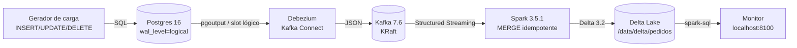

# CDC Lakehouse — CDC em tempo real de Postgres para Delta Lake

**Repositório:** https://github.com/ArthurTheWorld/Project-B

Pipeline de **Change Data Capture** de ponta a ponta: as mudanças de um banco
transacional viram eventos, os eventos viram tabelas analíticas, e as tabelas
analíticas viram métricas em um painel. Tudo roda local, em Docker Compose.

O objetivo do projeto é provar três coisas que separam um "pipeline de tutorial"
de um pipeline que serve para produção:

| Propriedade | Como é provada aqui |
|---|---|
| **Idempotência** | `MERGE` por chave primária; reprocessar o histórico inteiro não duplica nada |
| **Evolução de schema** | Coluna nova na origem chega ao Delta e é absorvida sem reiniciar o job |
| **Deletes** | `DELETE` na origem vira `DELETE` no lake (coisa que polling nunca vê) |

Este repositório contém **dois projetos**:

- **Projeto A (este diretório)** — a plataforma CDC: Postgres → Debezium → Kafka → Spark → Delta Lake → painel.
- **[Projeto B](project-b/)** — a camada de confiabilidade sobre a plataforma: catálogo de SLOs, suítes de expectations, runbooks de incidente, rastreamento de MTTR e lineage com OpenLineage.

---

## Arquitetura



O caminho do dado, em uma frase: o Debezium lê o **WAL lógico** do Postgres
(não faz polling), publica cada alteração no Kafka, e o Spark consome o tópico e
aplica cada micro-lote no Delta com um `MERGE` por `pedido_id`.

---

## Stack e portas

| Serviço | Imagem / versão | Porta no host | Para que serve |
|---|---|---|---|
| `postgres` | `postgres:16` | **5435** → 5432 | Fonte OLTP, com `wal_level=logical` |
| `kafka` | `confluentinc/cp-kafka:7.6.1` | **9092** | Barramento de eventos (KRaft, sem Zookeeper) |
| `connect` | `debezium/connect:3.0.0.Final` | **8083** | Kafka Connect + conector Debezium |
| `connector-init` | `curlimages/curl` | — | Registra o conector uma vez e encerra |
| `generator` | build local (`generator/`) | — | Simula a operação do e-commerce |
| `spark` | build local (`spark/`) | — | Consome o Kafka e escreve no Delta |
| `monitor` | processo local (`monitor/`) | **8100** | Painel de latência e vazão |

Credenciais do Postgres: banco `loja`, usuário `loja`, senha `loja`.

---

## Pré-requisitos

- **Docker Desktop** com pelo menos 5 GB de RAM liberados
- **PowerShell** (os scripts auxiliares são `.ps1`) — ou rode os comandos
  `docker compose` na mão, em qualquer shell
- **Python 3.10+** apenas para rodar o monitor e os testes
- **Git**

---

## Como subir

O jeito mais direto:

```powershell
.\scripts\start.ps1
```

Ou manualmente:

```powershell
docker compose up -d --build
docker compose ps
```

A primeira subida demora mais: o Spark baixa os jars do Delta e do conector
Kafka, e o Debezium precisa criar o slot de replicação.

### Serviços que devem ficar de pé

- `postgres`, `kafka`, `connect` → **healthy**
- `connector-init` → **exited (0)** — isso é o esperado: ele registra o conector
  e encerra
- `generator`, `spark` → **running**

---

## Verificando se o pipeline está vivo

**1. O conector Debezium está rodando?**

```powershell
curl http://localhost:8083/connectors/loja-pedidos/status
```

O esperado é `"state":"RUNNING"` no `connector` e em cada `task`.

**2. Os eventos estão chegando no Kafka?**

```powershell
docker compose exec kafka kafka-console-consumer `
  --bootstrap-server localhost:29092 `
  --topic loja.loja.pedidos `
  --max-messages 3
```

**3. A origem e o lake batem?**

```powershell
docker compose exec postgres psql -U loja -d loja -c "select count(*) from loja.pedidos;"

docker compose exec spark /opt/spark/bin/spark-sql `
  --packages io.delta:delta-spark_2.12:3.2.0 `
  --conf spark.sql.extensions=io.delta.sql.DeltaSparkSessionExtension `
  --conf spark.sql.catalog.spark_catalog=org.apache.spark.sql.delta.catalog.DeltaCatalog `
  -f /opt/sql/verificacao.sql
```

---

## Provar a idempotência

```powershell
.\scripts\demo-replay.ps1
```

O script faz o seguinte: para o gerador para estabilizar a contagem, mede o
Delta, **apaga o checkpoint** e reinicia o Spark, forçando o reprocessamento de
*todos* os eventos desde o começo. Depois compara as contagens.

Se o `MERGE` está correto, o número de linhas no Delta é o mesmo antes e depois
— reprocessar o histórico inteiro não cria duplicata nenhuma, porque a chave do
merge (`pedido_id`) é a mesma chave primária da origem.

---

## Provar a evolução de schema

```powershell
.\scripts\demo-evolucao.ps1
```

O script adiciona uma coluna na origem e atualiza algumas linhas:

```sql
alter table loja.pedidos add column cupom text;
update loja.pedidos set cupom = 'BLACK50' where pedido_id % 7 = 0;
```

Com `spark.databricks.delta.schema.autoMerge.enabled=true`, a coluna nova
atravessa Debezium → Kafka → Spark → Delta **sem reiniciar nenhum container**.
O script espera ~35 s (o trigger do streaming é de 10 s) e mostra o schema
resultante.

---

## Monitor de métricas

O painel é um servidor próprio, `http.server` da stdlib — sem Metabase, sem
Grafana, sem container extra.

```powershell
# a partir da raiz do repositório
python -m monitor.servidor
```

Abra **http://localhost:8100**. A página consulta `/api/metricas` a cada 15 s.

O que ele mostra:

- **Latência** ponta a ponta (`p50`, `p95`, máxima), calculada como
  `_ingerido_em − _evento_em`
- **Vazão** por minuto
- **Contagem no lake vs. contagem na origem** — a divergência denuncia atraso
- Distribuição por operação (`c`/`u`/`d`) e por status do pedido

Detalhe de implementação: a coleta sobe um Spark efêmero a cada consulta
(~4 s), de propósito. O container do Spark já tem os jars do Delta resolvidos;
um leitor Python (DuckDB/`deltalake`) exigiria uma segunda forma de ler a mesma
tabela — duas fontes de verdade para o mesmo número.

---

## Estrutura do repositório

```
cdc-lakehouse/
├─ docker-compose.yml            # a stack inteira (Projeto A)
├─ .env.example                  # variáveis ajustáveis (copie para .env)
├─ plano_projeto_A.md            # plano de 90 dias da plataforma CDC
├─ postgres/init/01_schema.sql   # schema OLTP + replica identity full
├─ debezium/loja-pedidos.json    # configuração do conector
├─ generator/carga.py            # gerador de carga (INSERT/UPDATE/DELETE)
├─ spark/
│  ├─ job.py                     # Structured Streaming + foreachBatch
│  ├─ merge_sql.py               # montagem do MERGE (testável sem Spark)
│  └─ Dockerfile
├─ monitor/
│  ├─ coleta.py                  # coleta de métricas via spark-sql
│  ├─ servidor.py                # API + servidor do painel
│  └─ index.html                 # o painel
├─ sql/                          # verificacao, evolucao, coleta, metricas
├─ scripts/                      # start, parar, demo-replay, demo-evolucao
├─ tests/
│  ├─ test_merge_sql.py          # testes do MERGE
│  └─ test_job_contrato.py       # contrato estático do job (schema, ordem do MERGE, OpenLineage opt-in)
├─ docs/decisoes.md              # ADRs (001 a 008)
├─ .github/workflows/ci.yml      # CI do Projeto A: compileall + pytest + compose config
└─ project-b/                    # Projeto B: confiabilidade de dados
   ├─ README.md
   ├─ slo_catalog.yaml           # catálogo de SLOs por tabela
   ├─ spark_openlineage_config.md
   ├─ expectations/              # suítes Python (pedidos e mercado)
   ├─ runbooks/                  # latência alta, volume inesperado, schema change
   ├─ dashboards/metabase_health.json
   ├─ scripts/                   # run_expectations, mttr_tracker, simuladores
   └─ .github/workflows/ci.yml   # CI do Projeto B
```

---

## Configuração

Copie `.env.example` para `.env` e ajuste:

| Variável | Padrão | Efeito |
|---|---|---|
| `INTERVALO_MS` | `400` | Intervalo entre operações do gerador. **Menor = mais carga** |
| `STARTING_OFFSETS` | `earliest` | De onde o Spark lê quando **não** há checkpoint (`earliest`/`latest`) |

O gerador também aceita `TAXA_UPDATE` (padrão `0.35`) e `TAXA_DELETE`
(padrão `0.02`); o resto das operações vira `INSERT`.

> **Nota sobre volume:** com `INTERVALO_MS=400`, o gerador produz cerca de
> **2,5 eventos/s** — o suficiente para demonstrar o pipeline, não para medir
> escala. Volume alto é justamente um dos itens do roadmap abaixo.

### OpenLineage (opcional, desligado por padrão)

A instrumentação de lineage **não é feita em Python**. Em Spark, OpenLineage é um
*listener* Scala habilitado por configuração — um `import` Python de
`openlineage.client` não existe no classpath do job e derrubava a subida.
O job em `spark/job.py` roda 100% sem OpenLineage; a ativação é opt-in pelo
ambiente:

| Variável | Padrão | Efeito |
|---|---|---|
| `OPENLINEAGE_ENABLED` | `false` | `true` adiciona o listener e o jar ao `spark-submit` |
| `OPENLINEAGE_TRANSPORT` | `console` | Transporte do listener (`console`, `file`, `http`…) |
| `OPENLINEAGE_URL` | *(vazio)* | Endpoint do Marquez/backend, quando o transporte é `http` |
| `OPENLINEAGE_NAMESPACE` | `cdc-lakehouse` | Namespace dos jobs |
| `OPENLINEAGE_PACKAGE` | `io.openlineage:openlineage-spark_2.12:1.9.1` | Coordenada Maven do listener |

```powershell
$env:OPENLINEAGE_ENABLED = "true"; docker compose up -d spark
```

Com o default (`false`), o comando do container é idêntico ao de antes desta
mudança — nenhum jar extra é baixado e nenhuma config é aplicada.

---

## Testes e CI

```powershell
python -m pytest -q
```

O CI (`.github/workflows/ci.yml`) roda a cada push/PR em `main`:

1. `python -m compileall -q generator spark tests` — sintaxe
2. `pytest -q` — testes
3. `docker compose config --quiet` — validade do Compose

---

## Decisões de arquitetura

As escolhas e o **porquê** de cada uma estão em
[`docs/decisoes.md`](docs/decisoes.md) — CDC por WAL em vez de polling,
`REPLICA IDENTITY FULL`, JSON em vez de Avro, `MERGE` em vez de append,
`foreachBatch`, Delta Lake, um tópico por tabela e gerador próprio.

Vale ler os "contras" de cada ADR: eles são a lista honesta do que este projeto
ainda não resolve.

---

## Estado atual e roadmap

**Funcionando (validado estaticamente):** captura CDC com deletes, merge
idempotente testado por replay, evolução de schema sem downtime, monitor de
latência/vazão e CI.

> **Ressalva honesta:** o Docker Desktop esteve parado durante a maior parte do
> desenvolvimento recente. Os testes de contrato, o `compileall` e o
> `docker compose config` passam, mas **a execução end-to-end contra
> Kafka/Spark/Postgres não foi provada** nesta rodada. Suba a stack com
> `.\scripts\start.ps1` e siga a seção de verificação para confirmar.

**Projeto B (entregue):** SLOs declarados em [`project-b/slo_catalog.yaml`](project-b/slo_catalog.yaml),
suítes de expectations em Python puro para `loja.pedidos` e
`stg_coingecko__mercado`, três runbooks de incidente, simuladores de falha,
`mttr_tracker.py` para medir tempo de recuperação, dashboard Metabase e
lineage opt-in com OpenLineage. Detalhes em [`project-b/README.md`](project-b/README.md).

**Ainda não existe neste repositório** (não procure, não está lá):

- **Avro + Schema Registry** — hoje o formato é JSON sem contrato. É o item
  nº 1 do roadmap, por ser a maior distância até "produção".
- **Compactação (`OPTIMIZE`/`VACUUM`)** — sem isso, o Delta acumula small files.
- **Escala real** — não há teste com dezenas de GB, nem tratamento de *skew*.
  As metas do plano (5 000 ev/s, p95 ≤ 2 s) **não foram medidas**.
- **dbt / camada silver e gold** — o lake tem a tabela bronze; as camadas
  analíticas estão no plano, não no código.
- **Metabase rodando** — o painel atual é o monitor da pasta `monitor/`; o
  Projeto B traz só a definição JSON do dashboard de saúde.
- **Alertas** — o monitor exibe, não notifica.

---

## Parar e limpar

```powershell
# Para tudo, preservando os dados (volumes)
.\scripts\parar.ps1

# Para tudo E apaga os dados (recomeça do zero)
docker compose down -v
```

---

## Licença

MIT.